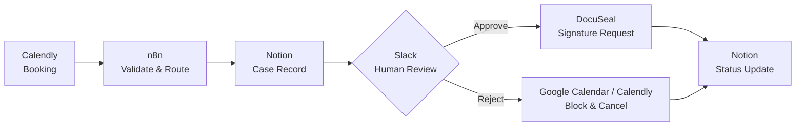

# Ordaro — Coaching Workflow Automation

**Course Demo | AI & Automation Project**

Ordaro is a prototype that connects booking, case management, human review, and digital agreements for a coaching service. It reduces repetitive administrative handoffs while keeping important decisions under human control.

> **Course showcase:** This public repository describes the project. It does not contain production credentials, personal client data, or a production-ready deployment.

## The problem

An appointment can require separate manual steps: collecting booking details, creating a case, reviewing the request, preparing an agreement, and updating the calendar. Working across disconnected tools increases coordination effort and the risk of missed follow-ups.

**Goal:** Connect the existing tools in a simple, traceable workflow without building an entirely new application.

## Workflow overview

1. **Intake:** Read booking and attendee information from Calendly.
2. **Validation:** Check required fields and create a case in Notion.
3. **Human review:** Request an approve/reject decision via Slack.
4. **Outcome:** Send a personalized agreement through DocuSeal on approval; coordinate the calendar and cancellation on rejection.
5. **Traceability:** Record case status and send relevant notifications.

## Tools used

| Tool | Purpose |
| --- | --- |
| **n8n** | Workflow orchestration |
| **Calendly** | Appointment bookings and attendee data |
| **Notion** | Case records and status tracking |
| **Slack** | Human-in-the-loop review |
| **DocuSeal** | Agreements and electronic signatures |
| **Brevo** | Transactional signature emails |
| **Google Calendar** | Calendar availability |

## Demo scope

The prototype focuses on external integrations, deterministic data validation, case persistence, human approval, and an agreement-signing workflow. An AI-assisted coaching preparation or error-diagnosis step is an **optional extension**, not an automated business decision.

**Current limitations:** Some integrations have been tested individually, but full negative-path and recovery testing is still ongoing. In particular, cross-system exactly-once guarantees, concurrent processing, and the complete calendar-blocking rejection path are not claimed as production-verified. Demo examples should use synthetic data.

## Next steps

- Complete end-to-end happy-path and failure-case tests.
- Verify calendar blocking and cancellation behavior.
- Improve error monitoring and recovery without adding unnecessary complexity.
- Prepare the final course demonstration and handover.

---

*Built as a course demonstration. Private operational workflows, settings, and integration credentials are maintained separately.*
