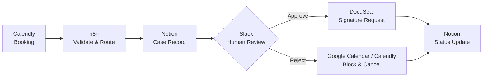

# Ordaro — Coaching Workflow Automation

**Course Demo | AI & Automation Project**

Ordaro is a prototype that connects booking, case management, human review, and digital agreements for a coaching service. It reduces repetitive administrative handoffs while keeping important decisions under human control.

> **Course showcase:** This public repository describes the project. It does not contain production credentials, personal client data, or a production-ready deployment.

## The problem

An appointment can require separate manual steps: collecting booking details, creating a case, reviewing the request, preparing an agreement, and updating the calendar. Working across disconnected tools increases coordination effort and the risk of missed follow-ups.

**Goal:** Connect the existing tools in a simple, traceable workflow without building an entirely new application.

## Workflow overview

1. **Intake:** Read booking and attendee information from Calendly.
2. **Validation:** Check required fields and create a case in Notion.
3. **Human review:** Request an approve/reject decision via Slack.
4. **Outcome:** Send a personalized agreement through DocuSeal on approval; coordinate the calendar and cancellation on rejection.
5. **Traceability:** Record case status and send relevant notifications.

## Tools used

| Tool | Purpose |
| --- | --- |
| **n8n** | Workflow orchestration |
| **Calendly** | Appointment bookings and attendee data |
| **Notion** | Case records and status tracking |
| **Slack** | Human-in-the-loop review |
| **DocuSeal** | Agreements and electronic signatures |
| **Brevo** | Transactional signature emails |
| **Google Calendar** | Calendar availability |

## Setup overview

The demonstration uses a self-hosted n8n instance and accounts or test environments for Calendly, Notion, Slack, DocuSeal, Google Calendar, and Brevo.

1. Configure the relevant integrations using n8n's **credential manager**; do not paste tokens into workflow JSON or GitHub.
2. Configure the Calendly booking source and Notion case database, including the expected fields and statuses.
3. Connect the main booking workflow to its approval subworkflow and select the intended Slack review destination.
4. Configure the DocuSeal agreement template and its transactional email delivery; verify the calendar used for booking conflicts before enabling rejection automation.
5. Use **synthetic test bookings** to verify the happy path and failure paths before enabling unattended execution.

**Availability:** The operational n8n exports, credentials, private case database, and instance-specific configuration are **not published in this showcase repository**. This is a setup overview, not a one-click deployment guide.

## Results and current verification

The following observations are based on development testing and operator reports, not an independently audited production rollout.

| Area | Observed result | Remaining verification |
| --- | --- | --- |
| Booking intake | Calendly API reads bookings and invitee details | Multi-booking replay and edge cases |
| Case records | Notion cases and relevant booking information have been created | Concurrent writes and complete recovery |
| Human review | Slack-based approve/reject interactions have been exercised | Repeated or stale decision handling |
| Agreements | DocuSeal creates personalized signature requests; email receipt via Brevo has been reported | Final English template and complete signing lifecycle |
| Rejection | Calendar blocking and cancellation path designed | Full block → verify → cancel live test |
| Error handling | Validation and error reporting paths designed | Automated failure notification and recovery tests |

No quantitative time savings, production delivery reliability, or exactly-once guarantees are claimed.

## Technical decisions and business value

- **Use existing services:** n8n connects tools already suited to scheduling, records, notifications, and signing instead of introducing a custom backend.
- **Keep critical decisions human-controlled:** Slack provides a review step before consequential actions.
- **Use deterministic logic where possible:** Validation, identifiers, prices, and status transitions should not depend on model-generated guesses.
- **Use Notion for the course prototype:** It is quick to inspect and demonstrate, but it is not a transactional database with guaranteed atomic state transitions.
- **Keep AI optional and bounded:** Potential AI support can summarize coaching requests or suggest error diagnostics. It is not required for business decisions or the demonstrated baseline.

For a business audience, the value is fewer manual handoffs and clearer case visibility. For a technical reviewer, the key design questions are safe integration boundaries, error handling, privacy, and what has actually been tested.

## Limitations and next steps

This is a **course prototype**, not a production-ready client management system. Cross-system partial failures, safe retries, concurrent approvals, and the end-to-end calendar-blocking rejection path require further hardening and verification.

- Complete positive and negative end-to-end test cases.
- Verify the rejection path and signing lifecycle.
- Test centralized error alerts and recovery scenarios.
- Add anonymized screenshots of the actual n8n canvas and case/review UI after checking them for sensitive information.
- Prepare the final demo and handover.

**n8n editor documentation:** Helpful node descriptions and sticky notes are part of the course requirement. Their completeness in the latest deployed workflow has **not** been independently verified by this public README.

---

*Built as a course demonstration. Private operational workflows, settings, and integration credentials are maintained separately.*
